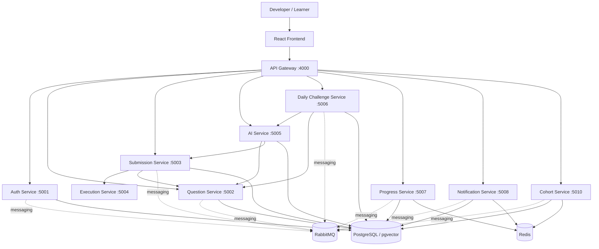

# Axly DSA Tracker

**An AI-assisted Data Structures & Algorithms learning platform built with a microservices architecture.**

Axly DSA Tracker is designed to help developers practise coding problems, submit solutions, monitor learning progress, and use an AI coach for learning support. This repository contains the platform's frontend, API gateway, backend services, and local infrastructure configuration.

> **Project status:** The repository is an actively evolving microservices codebase. The services and infrastructure are defined in the project, but setup success and every end-to-end user flow have not been independently verified. Treat the instructions below as a local development starting point.

## Highlights

- **DSA practice workflow:** A foundation for browsing problems and submitting solutions.
- **AI DSA coach:** An AI service intended to provide learning assistance using configured LLM providers.
- **Code execution architecture:** A dedicated execution service separates solution execution from the gateway and other application services.
- **Progress tracking:** A dedicated service manages learning-progress functionality.
- **Daily challenges:** A separate service supports daily challenge workflows.
- **Microservices separation:** Authentication, questions, submissions, execution, AI, progress, notifications, and cohorts have distinct service boundaries.
- **API gateway:** A single frontend entry point for routing requests to backend services.
- **Asynchronous messaging:** RabbitMQ is configured for inter-service messaging.
- **Data and caching infrastructure:** PostgreSQL with pgvector, Redis, and persistent Docker volumes.
- **Container-based development:** Docker Compose defines the infrastructure and application services.

## Architecture



The diagram shows the service topology and configured dependencies at a high level; it does not imply that every event flow or product workflow is complete.

## Services

| Component | Port | Responsibility |
|---|---:|---|
| Frontend | Vite default | Learner-facing React application |
| API Gateway | 4000 | Frontend entry point and service routing |
| Auth Service | 5001 | Authentication and identity workflows |
| Question Service | 5002 | DSA problem data |
| Submission Service | 5003 | Solution submission workflow |
| Execution Service | 5004 | Code execution boundary |
| AI Service | 5005 | AI-powered learning assistance |
| Daily Challenge Service | 5006 | Daily challenge workflows |
| Progress Service | 5007 | Learning progress |
| Notification Service | 5008 | Notification workflows |
| Cohort Service | 5010 | Cohort-related workflows |

Service ports are taken from the Docker Compose configuration. Check each service's implementation and environment settings for its actual supported endpoints.

## Technology stack

| Area | Technologies |
|---|---|
| Frontend | React, TypeScript, Vite |
| Backend | Node.js, TypeScript, Express-based services |
| API entry point | Custom API Gateway |
| Database | PostgreSQL with pgvector |
| Cache | Redis 7 |
| Messaging | RabbitMQ |
| Containers | Docker, Docker Compose |
| AI integrations | Configurable LLM API providers, including Groq, Gemini, and OpenAI-compatible endpoints |

Provider availability depends on valid credentials, model availability, and configuration. API keys are optional for infrastructure startup, but AI features that rely on a provider will need the appropriate key.

## Repository structure

```text
.
├── backend/
│   ├── gateway/          # API gateway
│   ├── packages/         # Shared backend packages
│   └── services/         # Independent application services
├── frontend/             # React + TypeScript + Vite app
├── infrastructure/       # Database initialization and infrastructure assets
├── docs/                 # Architecture, API and implementation inventories
├── scripts/              # Repository scripts
├── tests/                # Test assets
├── docker-compose.yml    # Local multi-container stack
├── package.json          # npm workspaces and root scripts
└── README.md
```

Useful documentation:
- [Architecture overview](docs/architecture.md)
- [Architecture audit](docs/architecture-audit.md)
- [API inventory](docs/api-inventory.md)
- [AI integration inventory](docs/ai-inventory.md)
- [Database ownership](docs/database-ownership.md)

## Getting started

### Prerequisites

- Git
- Node.js and npm (use a current Node.js LTS release compatible with the workspace dependencies)
- Docker Desktop or Docker Engine with the Docker Compose plugin
- LLM API credentials if you want to test provider-backed AI features

### 1. Clone the repository

```bash
git clone https://github.com/Ravikiran9988/axly-dsa-tracker-microservices.git
cd axly-dsa-tracker-microservices
```

### 2. Configure environment variables

The repository includes a Docker environment template at `.env.docker`. Review it before running the stack. Create a local `.env` file if your Compose setup expects one:

```bash
cp .env.docker .env
```

Update credentials and provider settings for your environment. At minimum, replace placeholder values for database credentials and `JWT_SECRET` before using the application beyond local development. Never commit real secrets or API keys.

If your environment uses a different variable-file convention, pass the appropriate file explicitly to Docker Compose.

### 3. Start the application stack

From the repository root:

```bash
docker compose up --build
```

This uses the root Compose configuration to start the configured infrastructure and application containers. On first startup, image builds and database initialization may take a few minutes.

To run in the background:

```bash
docker compose up --build -d
```

Check service status:

```bash
docker compose ps
```

Inspect logs for a particular service:

```bash
docker compose logs -f gateway
docker compose logs -f ai-service
```

Stop the stack:

```bash
docker compose down
```

To remove persisted database, Redis, and RabbitMQ volumes as well, run `docker compose down -v`. **This deletes local persisted data.**

### 4. Run workspace scripts

Install dependencies from the repository root:

```bash
npm install
```

Build all workspaces that define a build script:

```bash
npm run build
```

Run the configured workspace tests:

```bash
npm test
```

Start the configured development workspaces concurrently:

```bash
npm run dev:all
```

The root `dev:all` script starts the gateway, listed backend services, and frontend concurrently. Make sure the required infrastructure and environment variables are configured first. For troubleshooting, start the relevant workspace individually to isolate startup errors.

### 5. Run frontend or gateway separately

Frontend:

```bash
cd frontend
npm install
npm run dev
```

Gateway:

```bash
cd backend/gateway
npm install
npm run dev
```

For workspace-based development, prefer installing dependencies at the repository root and using npm workspace commands where possible.

## Environment and security

- Keep `.env`, provider keys, and production credentials out of Git.
- Use a unique, high-entropy `JWT_SECRET`; never use the Compose placeholder in a deployed environment.
- Change default database and RabbitMQ credentials before exposing services beyond a local machine.
- Do not expose the code execution service directly to untrusted networks. Code execution needs appropriate isolation, resource limits, timeouts, and security controls.
- Configure CORS, rate limits, and service-to-service access for the environment where the system runs.
- Do not treat local Docker Compose settings as a production deployment configuration.

## Development workflow

1. Pick the service responsible for the feature and review its package scripts and configuration.
2. Keep service boundaries clear; use the gateway for frontend-facing requests.
3. Update API and architecture documentation when contracts or service responsibilities change.
4. Run the relevant build and test scripts.
5. Test changes with the required infrastructure and document any manual verification.

## Contributing

Issues and pull requests for bug fixes, documentation improvements, tests, and learning features are welcome.

1. Fork the repository.
2. Create a focused branch for your change.
3. Explain the problem and proposed solution in your pull request.
4. Include test results and setup notes when relevant.

## License

No license file is currently referenced in this README. Unless a license is added to the repository, reuse and redistribution permissions may be limited.

---

**Axly DSA Tracker** — practise problem solving, understand your progress, and get AI-assisted learning support through a modular platform architecture.
